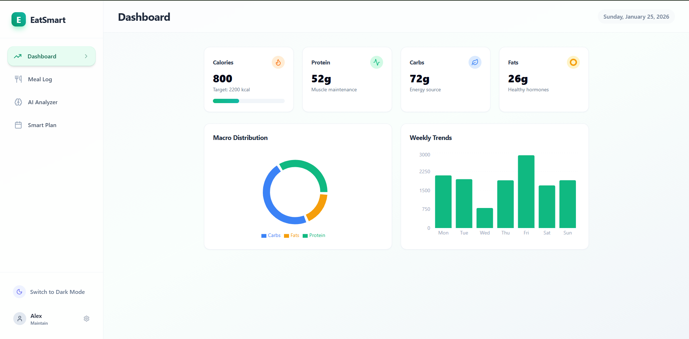
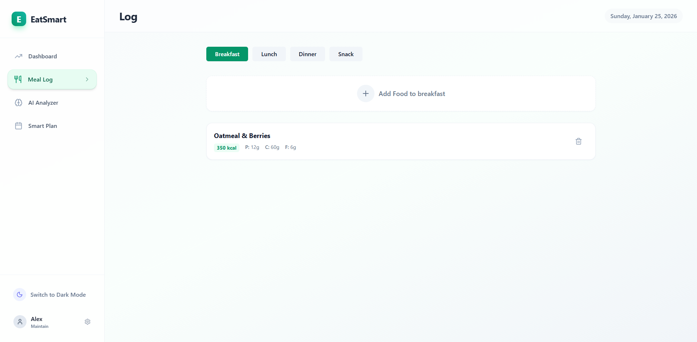
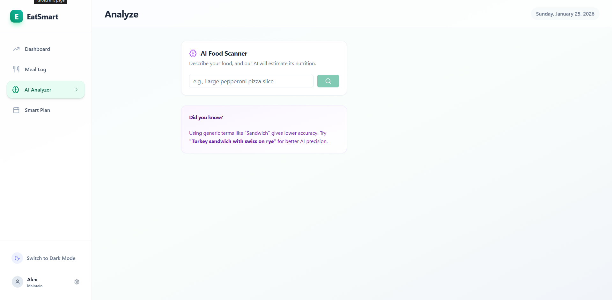
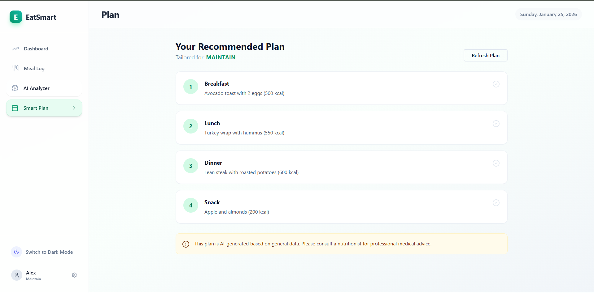

EatSmart – AI-Powered Nutrition Tracker
EatSmart is a modern nutrition tracking web app that helps users log meals, analyze food with AI, and receive smart health recommendations. It combines manual tracking with AI assistance to make healthy eating simpler and more insightful.
🚀 Features
📊 Dashboard Overview

Visual breakdown of daily nutrition including calories, protein, carbs, and fats. Includes macro distribution charts and weekly calorie trends. 

Dashboard

🍽 Meal Logger

Quickly log meals by category (breakfast, lunch, dinner, snack). Users can input custom macros and manage entries in a clean, interactive interface. 

MealLogger

🧠 AI Food Analyzer

Describe a food in plain language and AI estimates calories and macronutrients. Results include a confidence score and a health tip. Meals can be logged directly from AI results. 

AIAnalyzer

🗓 Smart Meal Planner

Generates AI-powered nutrition guidance based on the user’s health goal (lose, maintain, gain). Plans refresh automatically when goals change. 

SmartPlanner

👤 User Profile & Goals

Users can set their name, health goal, and daily calorie target to personalize insights across the app. 

App

🌗 Dark Mode Support

Built-in light and dark themes with system preference detection and manual toggle.

🧩 Tech Stack

React – Component-based UI

Tailwind CSS – Utility-first styling

Framer Motion – Smooth animations

Recharts – Data visualizations

Lucide Icons – Modern icon set

AI Service Layer – Handles food analysis and plan generation

📁 Project Structure
```
src/
│
├── components/
│   ├── Dashboard.jsx        # Nutrition summary & charts
│   ├── MealLogger.jsx       # Manual meal tracking
│   ├── AIAnalyzer.jsx       # AI food analysis tool
│   ├── SmartPlanner.jsx     # AI-generated health plans
│   └── ui/                  # Reusable UI components
│       ├── Button.jsx
│       ├── Card.jsx
│       ├── Input.jsx
│       ├── Select.jsx
│       └── Badge.jsx
│
├── services/
│   └── aiService.js         # AI integration logic
│
├── lib/
│   └── utils.js             # Utility helpers
│
└── App.jsx                  # Main app layout and routing logic
```

⚙️ Installation
```
git clone https://github.com/yourusername/eatsmart.git
cd eatsmart
npm install
npm start
```
🔌 Environment Setup

The AI features rely on an external AI service.

Create a .env file in the root directory:
```
REACT_APP_AI_API_KEY=your_api_key_here
```

🧠 How the AI Works

Food Analysis: Users type a food description → AI estimates macros → confidence score returned

Smart Planning: User goal is sent to AI → structured daily/weekly guidance returned

The AI service is abstracted so different providers (OpenAI, Claude, etc.) can be plugged in without changing UI components.

🎯 Future Improvements

Barcode food scanning

Persistent database storage

Progress tracking over months

Wearable device integration

Macro goal customization (not just calories)

📸 Screenshots








